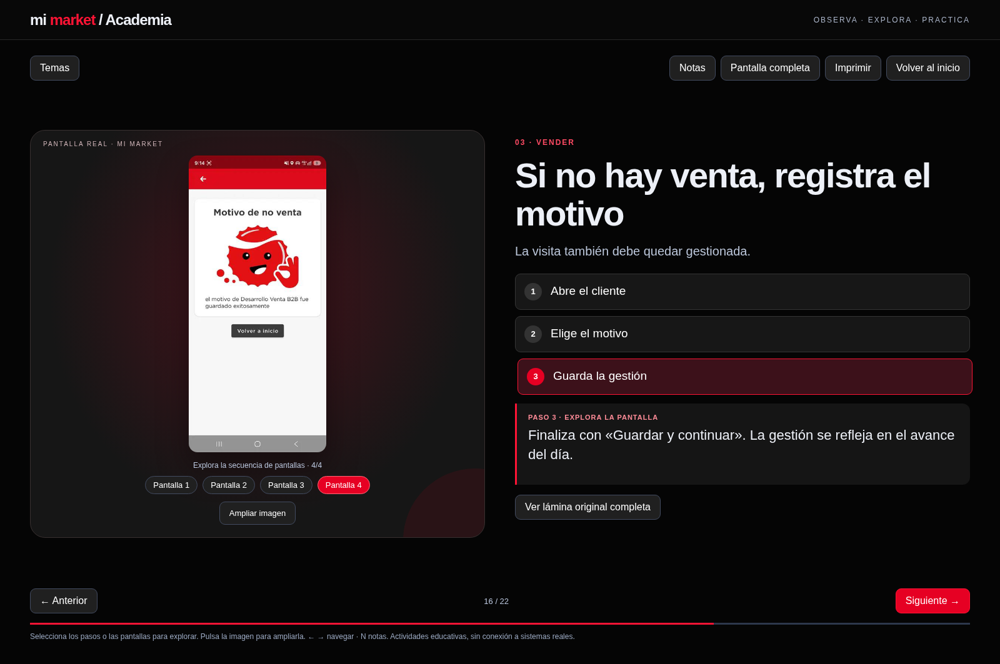

# Mi Market · Presentación comercial interactiva

Versión visual en negro, rojo y blanco, con capturas originales integradas.

## Abrir la presentación

[Descargar presentación web](https://raw.githubusercontent.com/josehernandeziturra88-ship-it/MMKT/main/Mi-Market-interactiva.zip). Descomprime y abre `Mi-Market-presentacion.html` con Chrome, Edge o Firefox. Todas las imágenes están incorporadas; no requiere instalar programas ni conexión a internet después de descargar.

Selecciona los pasos para explorar las explicaciones, cambia de pantalla con los controles, amplía las imágenes y responde los casos prácticos. Usa Pantalla completa para proyectar. Los ejercicios no se conectan a la aplicación real.

## Ver como sitio web

El archivo index.html está preparado para GitHub Pages. En Settings → Pages, selecciona Deploy from a branch → main → / (root) y guarda. La URL estará disponible cuando GitHub complete la publicación: https://josehernandeziturra88-ship-it.github.io/MMKT/ . La subida de archivos no implica que Pages esté activado.

Esta versión web reemplaza como entrega principal a la propuesta inicial de PowerPoint. El PDF visual es estático. Validar con el responsable las políticas y condiciones comerciales del material fuente antes de capacitar.
