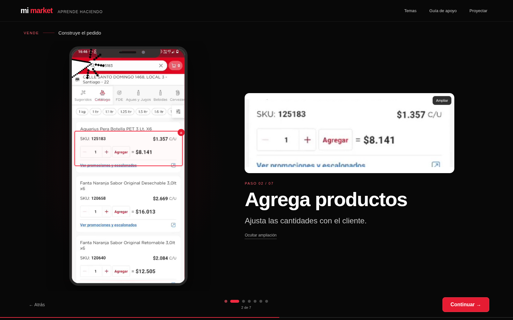
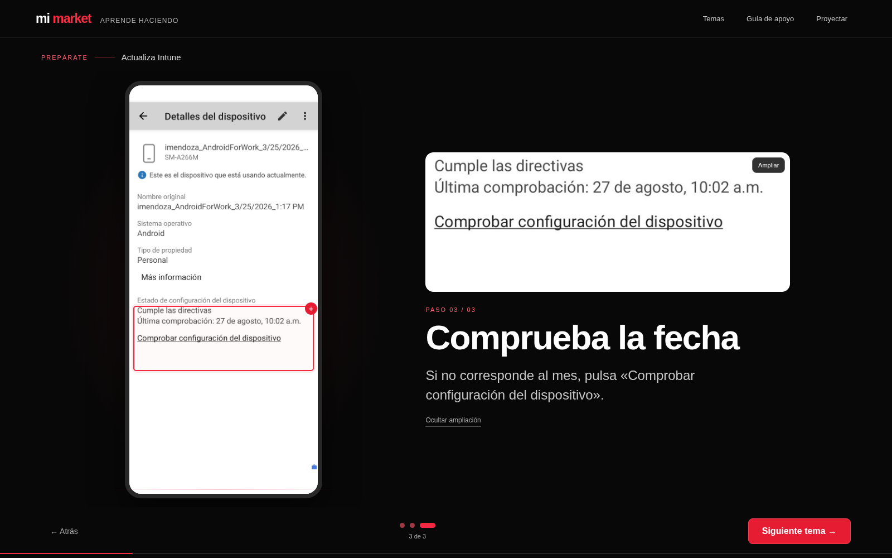

# Mi Market · Aprende haciendo

**Esta es la versión visual actual para capacitar a la fuerza de venta.**

[Descargar la presentación visual · 10 MB](https://raw.githubusercontent.com/josehernandeziturra88-ship-it/MMKT/main/Mi-Market-visual.zip). Descomprime y abre **Mi-Market-aprende.html** en Chrome, Edge o Firefox. No necesita conexión ni instalaciones.

Cada paso muestra el teléfono, una zona ampliada y una acción corta. Usa **Continuar** o las flechas para avanzar. **Temas** permite elegir un proceso; **Guía de apoyo** conserva las reglas y referencias fuera de las pantallas principales.

Se seleccionaron 67 fotogramas de las 16 grabaciones originales, además de las capturas del PowerPoint. Se recortó el área del teléfono sin recrear su interfaz. Las herramientas aparecen una a una; los procesos se explican mediante secuencias de imágenes en lugar de reproducir videos. Incluye prácticas con respuesta.

Las versiones previas con videos y PowerPoint permanecen como antecedentes; para esta capacitación utiliza **Mi-Market-visual.zip**.
