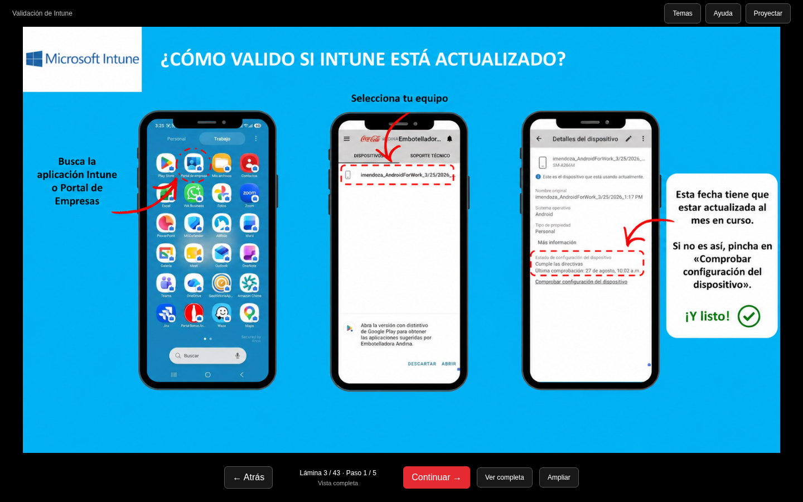

# Mi Market · Presentación final

Entrega completa con el estilo aprobado: composición original, apariciones por clic, secuencias de capturas de los procesos y ampliaciones. Intune incorpora el recuadro de texto, la eliminación de la flecha inferior y el check verde.

**[Descargar el paquete final completo · 77 MB](https://raw.githubusercontent.com/josehernandeziturra88-ship-it/MMKT/main/Mi-Market-Final.zip)**

**[Descargar solo el PowerPoint · 35 MB](https://raw.githubusercontent.com/josehernandeziturra88-ship-it/MMKT/main/final/Mi-Market-Final.pptx)**

## Cómo usarlo

Para la versión web, descomprime el paquete completo y abre **Presentacion.html**. Mantén la carpeta **recursos** junto al archivo. Pulsa Proyectar y avanza con Continuar o las flechas. Temas permite elegir una lámina y activar el material complementario. Ver completa y Ampliar permiten consultar los detalles y regresar al paso.

Para PowerPoint, abre **Mi-Market-Final.pptx** y activa **Presentación con diapositivas**. Los clics hacen aparecer la siguiente parte de la lámina. Es una copia para exponer basada en imágenes; los textos no son objetos editables independientes. El archivo original permanece intacto.

Se conservan las 43 láminas originales: 24 en el recorrido y 19 ocultas como material complementario. Las secuencias usan capturas extraídas de los 16 videos originales. La organización de láminas ocultas coincide con la del archivo fuente.

Comprobado: carga de los 250 estados visuales con archivos locales y sin conexión; navegación, índice, ampliaciones del paso actual, vista completa y material de apoyo. PowerPoint importa las 43 láminas y reconoce las 207 apariciones. El ZIP final pasó la comprobación de integridad.

Las carpetas de revisión y las propuestas previas permanecen como antecedentes. La entrega que debes utilizar es **Mi-Market-Final.zip** o **final/Mi-Market-Final.pptx**.
