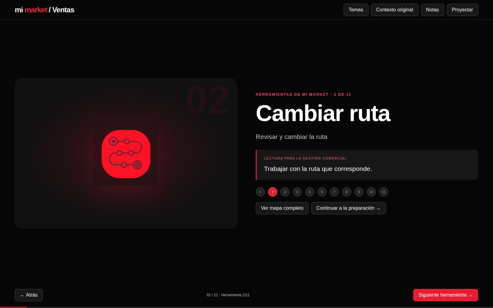
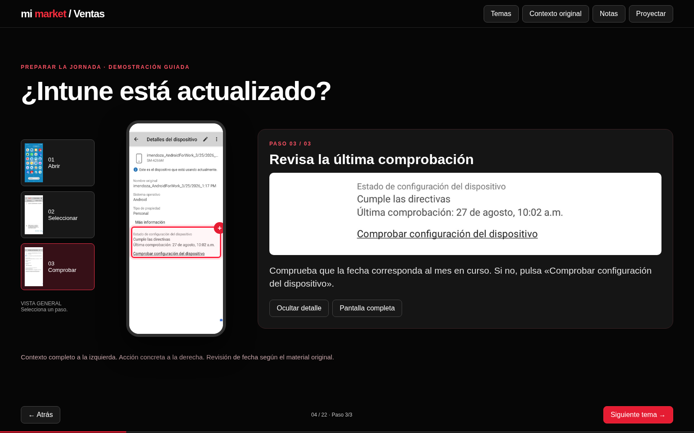

# Mi Market · Capacitación para gerencia de ventas

Presentación web con imágenes originales, identidad negra, roja y blanca y explicación progresiva.

[Descargar la versión para gerencia](https://raw.githubusercontent.com/josehernandeziturra88-ship-it/MMKT/main/MMKT-Gerencia-interactiva.zip). Descomprime y abre **Mi-Market-Gerencia.html** en Chrome, Edge o Firefox. No necesitas instalar programas ni mover imágenes: están incorporadas en el archivo.

## Recorrido visual

- Las 11 herramientas se muestran individualmente, con su función y una lectura para la gestión comercial. El mapa completo está disponible al solicitarlo.
- Intune: 3 pasos, contexto de los tres teléfonos, pantalla completa y zona de detalle ampliada. Selecciona los pasos o pulsa la zona marcada.
- El resto de los temas avanza una idea por clic, conservando las capturas originales.
- Incluye preguntas con respuestas, lista de preparación, notas y modo de proyección. Flechas o espacio para avanzar.

## Estado del contenido

Esta entrega no incluye videos: no se encontraron videos incrustados ni vínculos a videos en el PowerPoint disponible. La incorporación de videos requiere el archivo original o los medios correspondientes. Los ejercicios no ejecutan acciones en Mi Market.

Verificar con el responsable la política de contraseñas, mínimo de compra y significado operativo de «cuotificado» antes de capacitar.

## Publicación web opcional

index.html está listo para GitHub Pages. Si Pages todavía no está activo, en Settings → Pages selecciona Deploy from a branch → main → / (root). La subida del archivo por sí sola no confirma que el sitio esté publicado.
