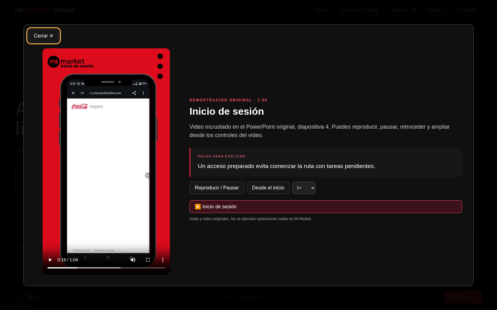

# Mi Market · Capacitación para gerencia de ventas

Presentación comercial web con imágenes originales, herramientas mostradas una a una, Intune con foco y zoom, y **16 videos originales reproducibles**. Contiene 41 temas navegables, incorporando negociación, instalación de equipos de frío y pedidos offline del PowerPoint completo.

## Descargar y abrir

[Descargar la presentación con todos los videos](https://github.com/josehernandeziturra88-ship-it/MMKT/archive/refs/heads/presentacion-web.zip).

1. Descarga y descomprime el ZIP completo.
2. Abre `index.html` con Chrome, Edge o Firefox.
3. Conserva la carpeta `videos` junto a `index.html`.
4. Usa **Proyectar** y las flechas para avanzar. Las herramientas y las explicaciones se muestran de forma progresiva.

Los botones **Reproducir demostración** abren los videos del tema. **Videos · 16** permite elegir cualquier demostración. Hay controles de pausa, reinicio, velocidad y pantalla completa. No hace falta PowerPoint ni conexión después de descargar.

## Contenido y validación

Fuente: PowerPoint original «Mi Market - General videos», 43 diapositivas. Los 16 MP4 se extrajeron sin recodificar y conservan su audio y calidad; sus hashes SHA-256 coinciden con los medios incrustados. El manifiesto registra duración y diapositiva de origen.

Se revisaron carga y duración de los 16 videos en Chromium, reproducción efectiva, pausa, velocidad, biblioteca, imágenes en los 41 temas, zoom de Intune y navegación móvil. Los ejercicios son educativos y no modifican Mi Market.

La sección de pedidos sin conexión se actualizó: admite clientes del día, requiere cerrar el pedido y conservar la caché; la bitácora permite revisar la transmisión al recuperar conexión. Las condiciones de la herramienta deben validarse con el responsable comercial antes de capacitar. La diapositiva 42 del original contiene apuntes de edición y no se presenta como una función adicional confirmada.

